# GeCe Sablon

Aplikasi mobile Android untuk UMKM **GeCe Screen Printing** (sablon DTF). Pelanggan dapat melihat katalog,
memesan, dan memantau status pesanan; admin workshop mengelola pesanan dan produksi; owner memantau keuangan dan pengaturan.

Proyek ini dikerjakan sebagai tugas Project-Based Learning (PjBL), Teknik Komputer dan Jaringan,
Politeknik Negeri Ujung Pandang.

## Status

| Bagian | Status |
|---|---|
| UI/UX (Figma) dan alur (draw.io) | Selesai |
| Aplikasi Android (data contoh) | [ISI: sedang dikerjakan] |
| Backend Laravel + MySQL | [ISI: belum dimulai] |
| Integrasi API | [ISI: belum dimulai] |

## Teknologi

| Bagian | Teknologi |
|---|---|
| Bahasa dan alat | Kotlin, Android Studio |
| Tampilan | Jetpack Compose + Material 3 |
| Arsitektur | MVVM + Repository Pattern |
| Jaringan | Retrofit + OkHttp + Kotlinx Serialization |
| Penyimpanan lokal | DataStore |
| Backend (repo terpisah) | Laravel + MySQL |

## Fitur per peran

- **Pelanggan:** katalog dan detail produk, pemesanan (warna, ukuran, jumlah, unggah desain), pelacakan status, riwayat, kontak WhatsApp.
- **Admin workshop:** manajemen pesanan, checklist produksi, kelola stok, pesanan manual.
- **Owner:** dashboard, keuangan dan laporan, kelola produk dan harga, kelola akun admin.

## Perkembangan mingguan

### Minggu 11: Desain UI/UX dan arsitektur
Perancangan UI/UX di Figma dan flowchart alur pengguna.

| Flowchart | Desain Figma |
|---|---|
|  | 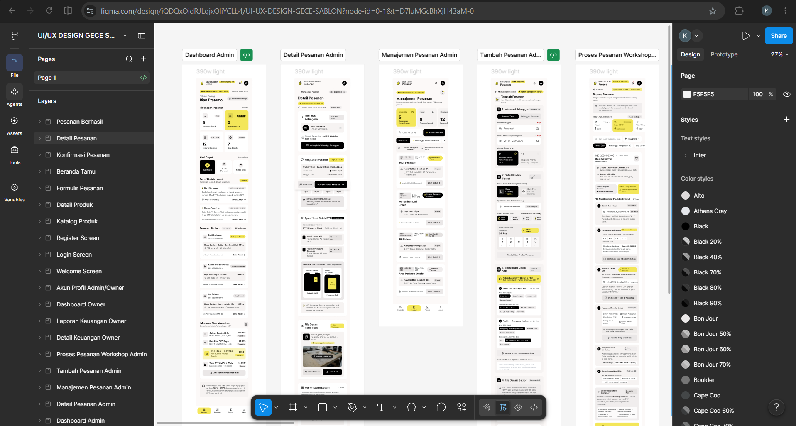 |

### Minggu 12: Layar awal, autentikasi, dan navigasi
Splash, onboarding, welcome, login, register, navigasi per peran, dan logout.

| Splash | Onboarding | Welcome | Login | Register |
|---|---|---|---|---|
|  | 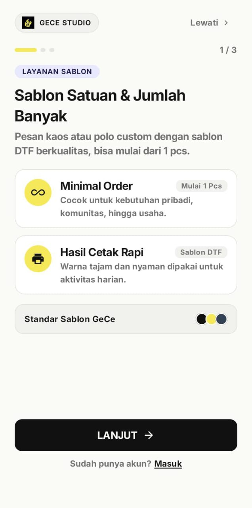 | 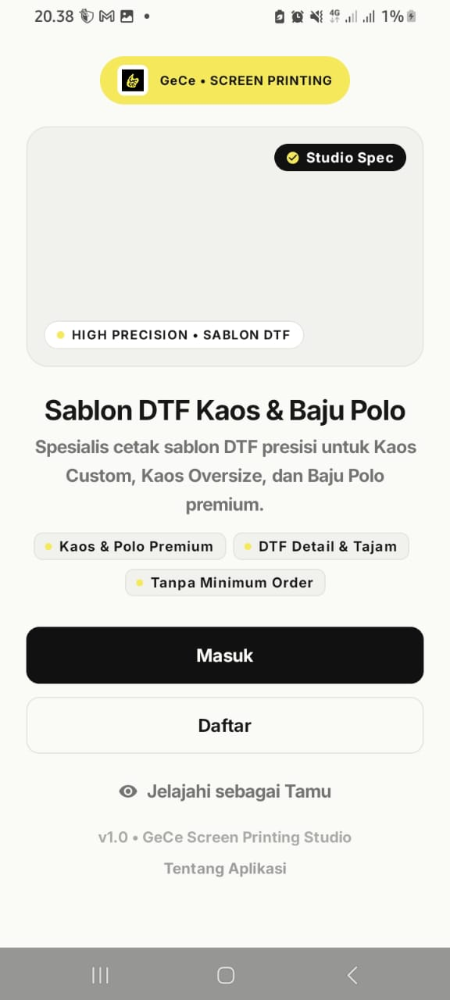 | 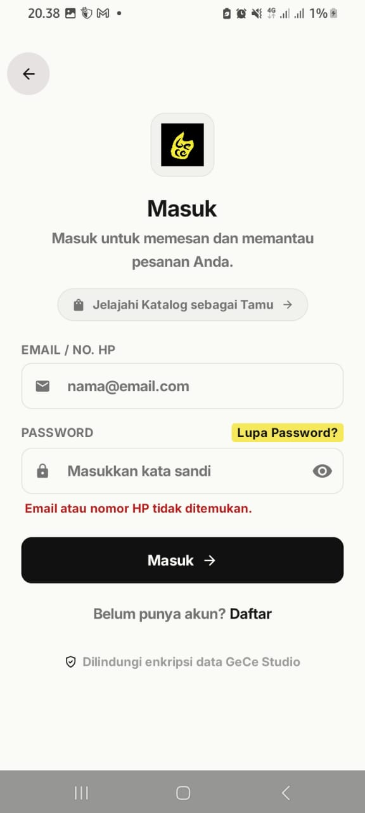 |  |

### Minggu 13: Fitur utama (data contoh)
Katalog dan pemesanan pelanggan, pesanan dan proses produksi staff, dashboard admin.

| Beranda | Katalog | Detail Produk | Form Pesanan | Detail Pesanan |
|---|---|---|---|---|
| 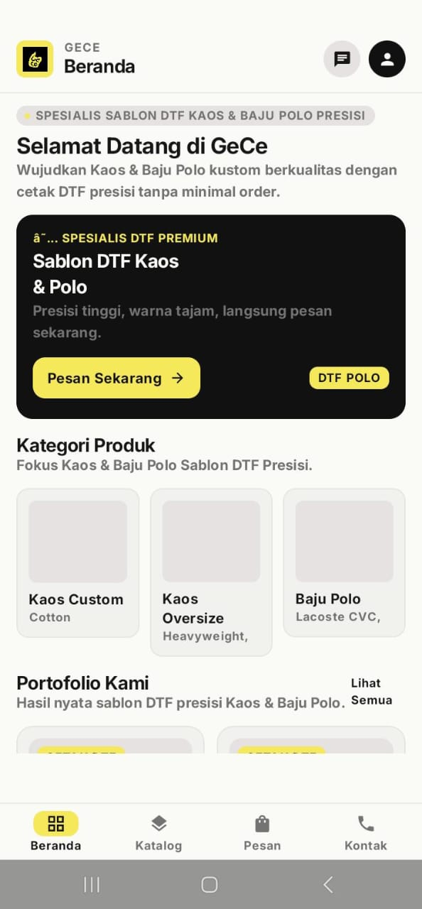 | 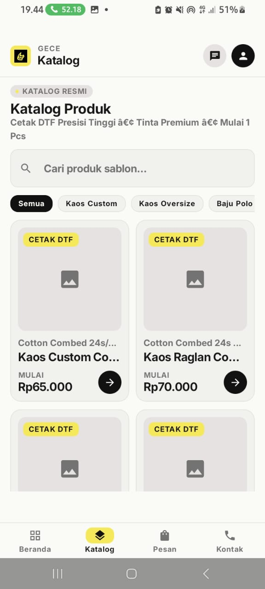 |  |  | 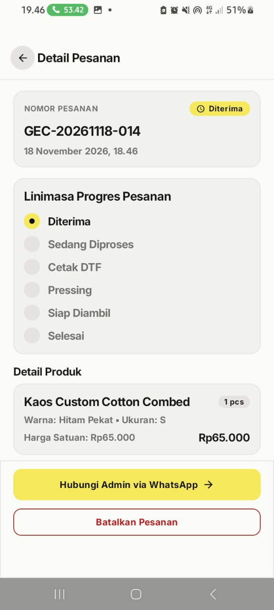 |

| Pesanan (Admin) | Proses Workshop | Detail Pesanan (Admin) | Dashboard Admin | Kelola Stok |
|---|---|---|---|---|
|  |  | 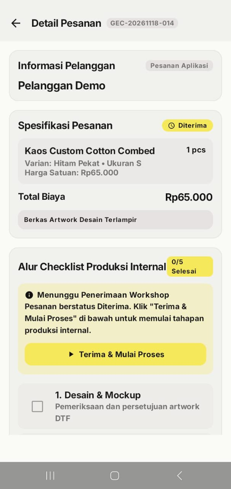 |  |  |

| Dashboard Owner | Ringkasan Keuangan | Laporan Keuangan |
|---|---|---|
|  | 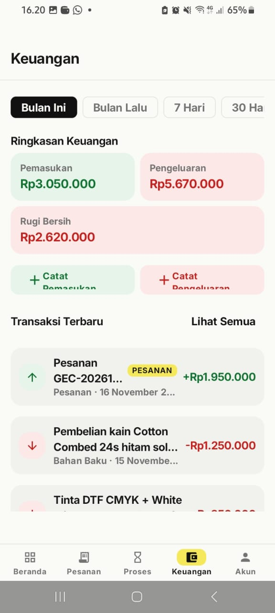 | 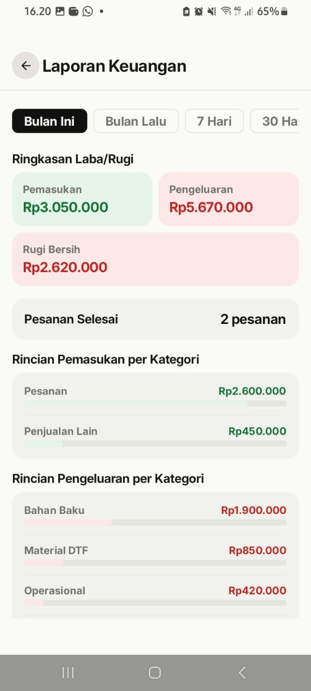 |

### ERD Database
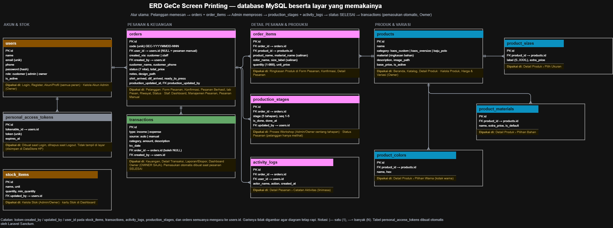

## Struktur proyek

```
app/src/main/java/com/gecesablon/app/
├── core/      (network, datastore, di, util)
├── data/      (model, remote, repository)
└── ui/        (theme, components, navigation, customer, admin, owner, staff, auth, ...)
docs/          (spesifikasi, desain, flowchart, tangkapan layar)
```